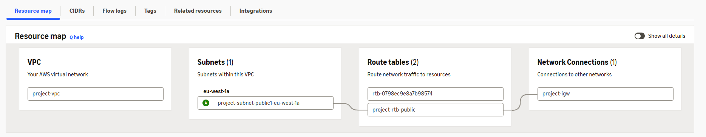
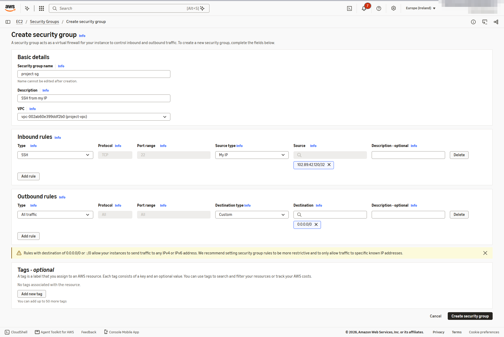
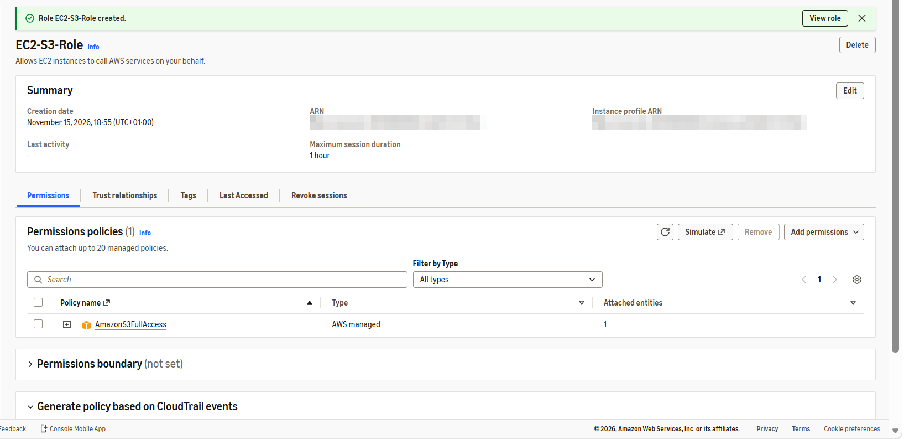
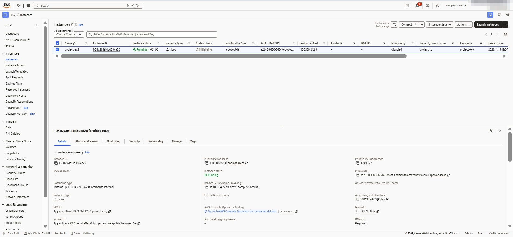
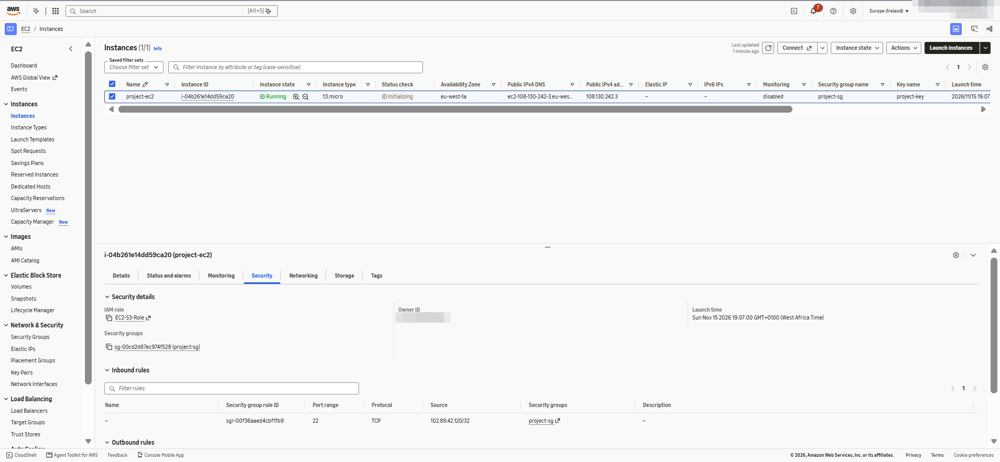
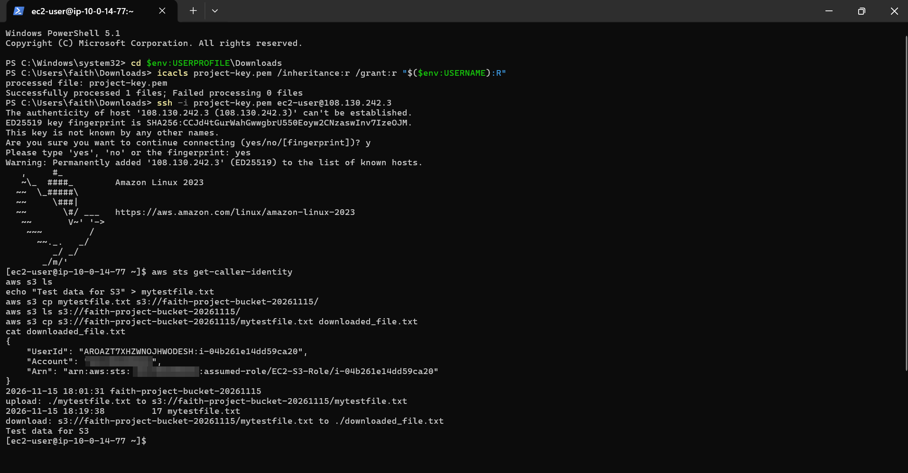
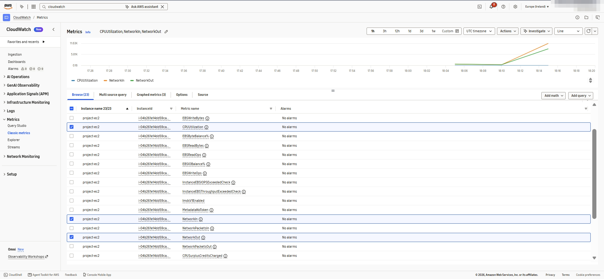
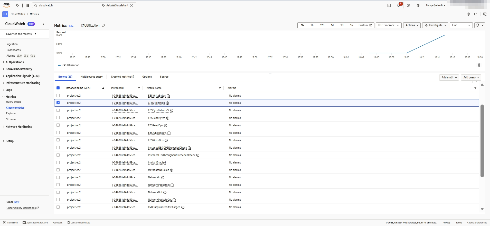

# AWS Project: VPC, EC2, IAM Role, S3 and CloudWatch

**Region:** Europe (Ireland) `eu-west-1`

This project builds a custom VPC with a public subnet, launches an EC2 instance with an IAM role, uses that role to reach an S3 bucket from the AWS CLI (no `aws configure`), and checks the instance's basic metrics in CloudWatch.

## Architecture

| Resource | Name / value |
|---|---|
| VPC | `project-vpc`, CIDR `10.0.0.0/16` |
| Public subnet | `project-subnet-public1-eu-west-1a` |
| Internet gateway | `project-igw` |
| Route table | `project-rtb-public` (route `0.0.0.0/0` to the internet gateway) |
| Security group | `project-sg` (SSH port 22 from my IP only, all outbound allowed) |
| IAM role | `EC2-S3-Role` with `AmazonS3FullAccess` |
| EC2 instance | `project-ec2`, Amazon Linux 2023, `t3.micro` |
| S3 bucket | `faith-project-bucket-20261115` |

## Step 1: VPC and network foundation

Created in the console with **VPC and more**: name `project`, IPv4 CIDR `10.0.0.0/16`, 1 Availability Zone, 1 public subnet, 0 private subnets, NAT gateways **None**, VPC endpoints **None**, DNS hostnames and DNS resolution enabled. This created the VPC, subnet, internet gateway and a public route table with a route to the internet gateway.

The resource map shows the subnet linked to the public route table, which is linked to the internet gateway.



## Step 2: Security group and IAM role

**Security group `project-sg`** (in `project-vpc`):
- Inbound: SSH, TCP 22, source = my IP (`/32`)
- Outbound: all traffic (default)



**IAM role `EC2-S3-Role`:**
- Trusted entity: AWS service, EC2
- Permissions: `AmazonS3FullAccess` (AWS managed). Full access was used rather than read-only because the task uploads a file.



## Step 3: EC2 instance

Launched `project-ec2` (Amazon Linux 2023, `t3.micro`) into the public subnet of `project-vpc` with auto-assign public IP enabled, security group `project-sg`, key pair `project-key`, and IAM instance profile `EC2-S3-Role`.




Connected over SSH from Windows PowerShell:

```powershell
icacls project-key.pem /inheritance:r /grant:r "$($env:USERNAME):R"
ssh -i project-key.pem ec2-user@<PUBLIC_IP>
```

## Step 4: S3 access from EC2 using the role

Created the bucket `faith-project-bucket-20261115` in `eu-west-1` (block all public access on, SSE-S3 encryption). Then, inside the SSH session, with no `aws configure`:

```bash
aws sts get-caller-identity            # shows assumed-role/EC2-S3-Role
aws s3 ls                              # lists buckets
echo "Test data for S3" > mytestfile.txt
aws s3 cp mytestfile.txt s3://faith-project-bucket-20261115/
aws s3 ls s3://faith-project-bucket-20261115/
aws s3 cp s3://faith-project-bucket-20261115/mytestfile.txt downloaded_file.txt
cat downloaded_file.txt                # prints: Test data for S3
```

`get-caller-identity` returned an `assumed-role/EC2-S3-Role/...` ARN, which shows the instance used the role's temporary credentials. Upload, listing and download all worked.



## Step 5: CloudWatch monitoring

CloudWatch, Metrics, Classic metrics, EC2, Per-Instance Metrics, filtered to this instance. Basic monitoring reports every 5 minutes. The graphs show `CPUUtilization`, `NetworkIn` and `NetworkOut`. Network traffic and CPU rise around the time of the SSH session and S3 transfer.




## Cleanup

After taking the screenshots, I terminated the instance, emptied and deleted the bucket, deleted the VPC and security group, deleted the IAM role, and deleted the key pair, so no resources keep running or cost anything.

## Notes

- Everything stayed within the Free plan, with no NAT gateway.
- The private key (`.pem`) is not included in this repository.
